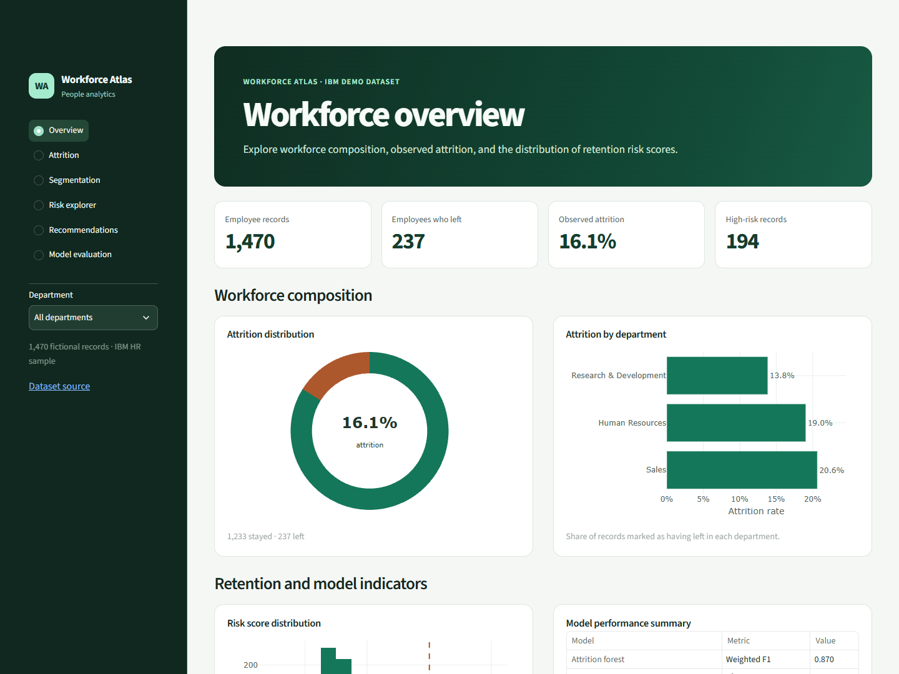
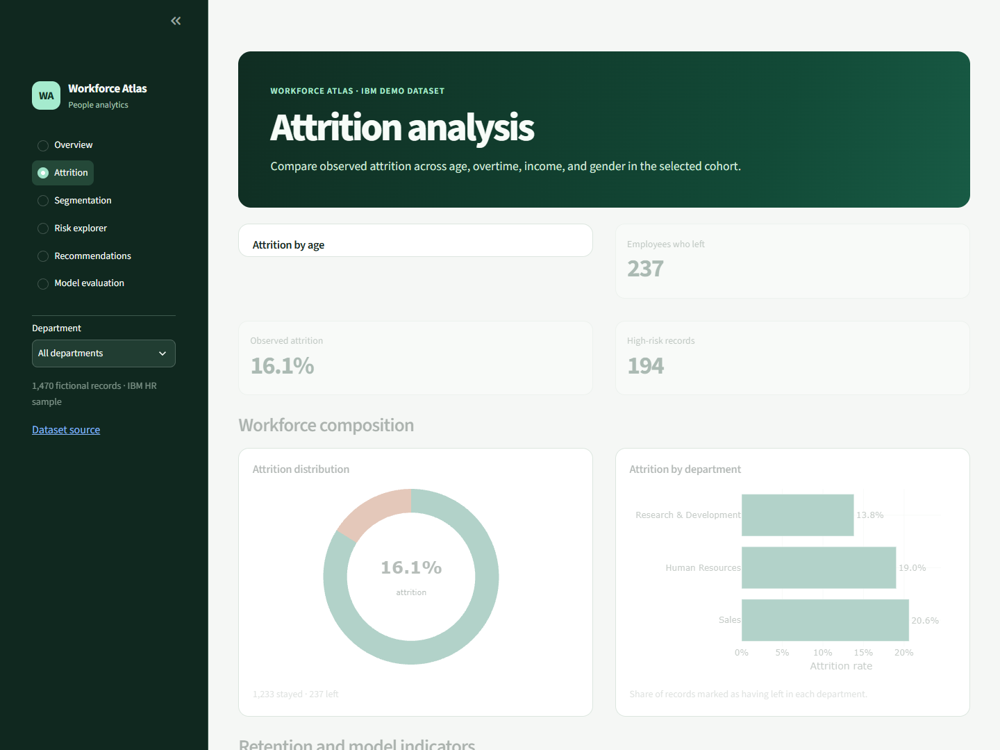
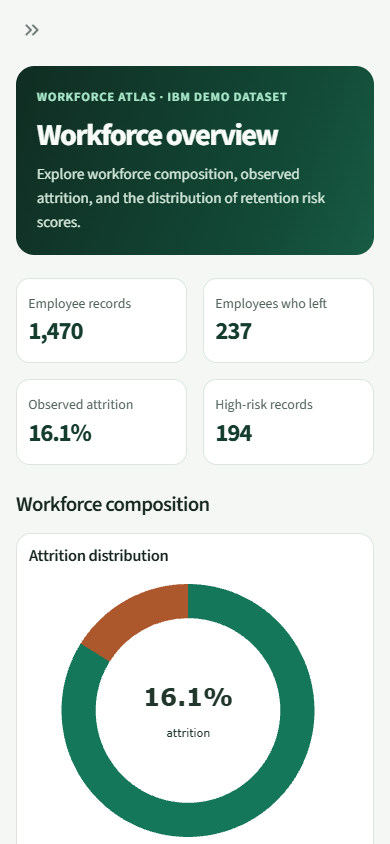

# Workforce Atlas

Workforce Atlas is an interactive people analytics dashboard built on IBM’s fictional employee attrition dataset. It helps readers explore which cohorts had higher observed attrition, how the K-means segments differ, and which records score highly under the project’s retention-risk rules.

The demo has 1,470 employee records, 237 observed departures, and 194 records that meet the default risk threshold of 0.60. See the source for field definitions and its published data license. [IBM HR Analytics Employee Attrition & Performance](https://www.kaggle.com/datasets/pavansubhasht/ibm-hr-analytics-attrition-dataset)

## Dashboard

| View | What you can explore |
| --- | --- |
| Overview | Headcount, attrition distribution, department comparisons, risk distribution, and model summary |
| Attrition | Observed attrition by age, overtime, and gender, plus income distributions by outcome |
| Segmentation | Three fitted employee segments, their profiles, and age, income, and experience charts |
| Risk explorer | Adjustable threshold, risk distribution by segment, and the 50 highest-scoring records |
| Recommendations | Cohort patterns and proposed actions to evaluate around workload, compensation, retention, and engagement |
| Model evaluation | Confusion matrix, classification and regression metrics, feature importance, and silhouette |

Select a department in the sidebar to filter the workforce views. On a phone, open the sidebar from the top-left control. Each view has a shareable URL. The Model evaluation page always describes the packaged release.

## Screenshots



| Attrition analysis | Mobile overview |
| --- | --- |
|  |  |

## Run locally

Python 3.12 is the tested runtime. Run these commands from the repository root.

```bash
python -m venv .venv
# macOS / Linux
source .venv/bin/activate
# Windows PowerShell
# .\.venv\Scripts\Activate.ps1
python -m pip install -r requirements.txt
python -m streamlit run src/dashboard.py
```

Open [localhost:8501](http://localhost:8501). The dashboard uses the checked-in demo release. It requires no Java, Spark, service credentials, or environment variables.

## Architecture

```text
IBM source CSV
  -> offline Spark preprocessing and feature engineering
  -> Random Forest classification and regression, K-means segmentation
  -> release archive with fitted pipelines, metrics, and a Parquet snapshot
       -> Streamlit reads and caches the dashboard snapshot
       -> Spark batch scoring loads the fitted pipelines
```

- `src/dashboard.py` serves the dashboard using Streamlit, Pandas, and Plotly.
- `hr_analytics/` contains the Spark transformations, training, batch inference, and reporting modules.
- `artifacts/demo.zip` contains a schema-versioned manifest, a curated snapshot, two fitted string-indexer pipelines, and the fitted scoring pipeline. The scoring pipeline includes vector assemblers, both forests, the scaler, and K-means.
- `data/`, `models/`, and `outputs/` retain the source CSV, baseline Spark artifacts, and original exploratory figures for reproducibility.

The app caches the decoded snapshot across sessions and invalidates it when the release file changes. It reads the snapshot and its metrics without starting a JVM. Training takes an exclusive lock per output directory and publishes the completed archive atomically. Failed runs leave any previously published archive usable.

## Models and scoring

| Model | Method | Evaluation |
| --- | --- | --- |
| Attrition | Class-weighted Spark Random Forest classifier | Accuracy, weighted F1, weighted precision and recall, confusion matrix |
| Performance rating | Spark Random Forest regressor | RMSE, MAE, R² |
| Employee segments | Standardized Spark K-means, k=3 | Silhouette on the fitted dataset |

Both forests use 100 trees with a maximum depth of 10. The shipped demo uses the original fitted forests. The reported supervised metrics are recalculated from the original engineered data using the seeded 80/20 evaluation split. The segmentation model was fitted offline on that same feature table. The pipeline retains the original engagement, satisfaction, experience, income, and risk features.

On the 254-record evaluation split, the classifier had 88.98% accuracy and 0.8701 weighted F1. It identified 11 of 35 recorded departures. The regressor had an RMSE of 0.0208 and R² of 0.9964. The segmentation silhouette was 0.4052.

Install the training dependencies in an environment with Java 17 and Python 3.12. Use Linux, WSL, or a compatible classic Spark environment for training and scoring. Native Windows model loading and Spark writes depend on Hadoop’s Windows native libraries.

```bash
python -m pip install -r requirements-training.txt
python main.py predict --data data/WA_Fn-UseC_-HR-Employee-Attrition.csv --output .artifacts/predictions.csv
python main.py train
python main.py train --reports
```

Batch scoring uses the local trained release when available and the bundled demo otherwise. Pass `--release` to select a specific file. The input uses the IBM CSV’s feature columns. `Attrition` is optional for scoring, `EmployeeNumber` is carried through when present, and the attrition model requires `PerformanceRating` as an input. The scores include the predicted attrition class, the model’s normalized score for departure, the predicted performance rating, the rule-based risk score, and the fitted segment.

The default training output is `.artifacts/workforce-atlas.zip`. Use `--data` and `--output` to set explicit paths. The `--reports` flag adds the three intermediate Parquet stages, exploratory plots, correlation and feature-importance charts, elbow analysis, and risk reports. Running `python main.py` preserves the full reporting workflow. To rebuild the fictional demo with the original forests:

```bash
python main.py train --reuse-original-forests --output .artifacts/demo-candidate.zip
python -m tests.check_prediction_parity .artifacts/demo-candidate.zip
```

The **Build model release** GitHub Actions workflow also supports explicit training or repackaging the original forests. Download its completed archive to review it. Publish only a verified release built from the fictional demo data to the public app. Keep private batches, outputs, and releases in access-controlled storage.

## Deployment

GitHub Pages publishes the public demo from a tested build of the same Streamlit entry point. The Pages build uses Stlite, which runs the dashboard locally in the browser and downloads its Python runtime on the first visit. The published files contain the curated demo snapshot and evaluation metrics. [Stlite browser runtime](https://stlite.net/browser/)

Streamlit Community Cloud can run `src/dashboard.py` with Python 3.12 and the root `requirements.txt`. The theme and application display settings live in `.streamlit/config.toml`. Use a staging branch or a separate app to verify navigation, charts, and empty states before promoting a release. [Streamlit Community Cloud deployment guide](https://docs.streamlit.io/deploy/streamlit-community-cloud/deploy-your-app/deploy)

The original project used Databricks for Spark execution. The reporting and training commands reuse an active Spark session when available. Dependencies and artifact paths must be accessible to that Spark runtime.

## Verification

```bash
python -m unittest discover -s tests -p "test_*.py" -v
python -m tests.check_prediction_parity
```

The parity check compares attrition labels, model scores, performance predictions, and risk scores from the bundled pipeline with the original Spark path across the full demo CSV. The browser smoke test requires Playwright and Chromium:

```bash
python -m pip install playwright
python -m playwright install chromium
python -m tests.check_browser http://localhost:8501
```

## Limitations

- The dataset is fictional and has no event timestamps. The dashboard presents a snapshot and shares with recorded attrition outcomes.
- The risk score is a rule-based combination of overtime, engagement, satisfaction, tenure, and income. The classifier score has no calibration guarantee.
- The original forests retain the historical pipeline, which fitted categorical preprocessing and calculated class weights on the full snapshot before evaluation. The resulting metrics are useful for reproduction and are limited as evidence of generalization.
- Performance rating is closely associated with salary hike in this dataset. The model metrics may overstate accuracy in other settings.
- The dataset includes demographic fields, and the project has no external validation or fairness audit. Use the dashboard for education and cohort exploration. The proposed policies are hypotheses for further investigation.

## Credits

Original project contributors include Mustafa Nabil, Mahmoud Hesham, Mariam Magdy, Omar Ahmed Wafik, and Yousef Hany. The original package metadata also credits Mohamed Nour.
