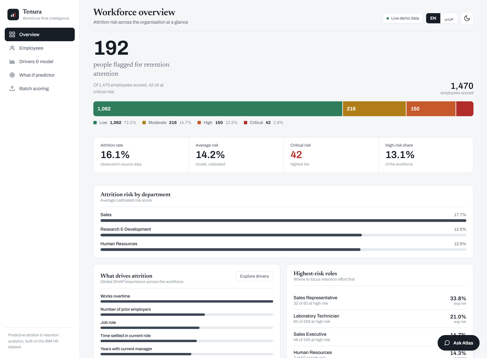
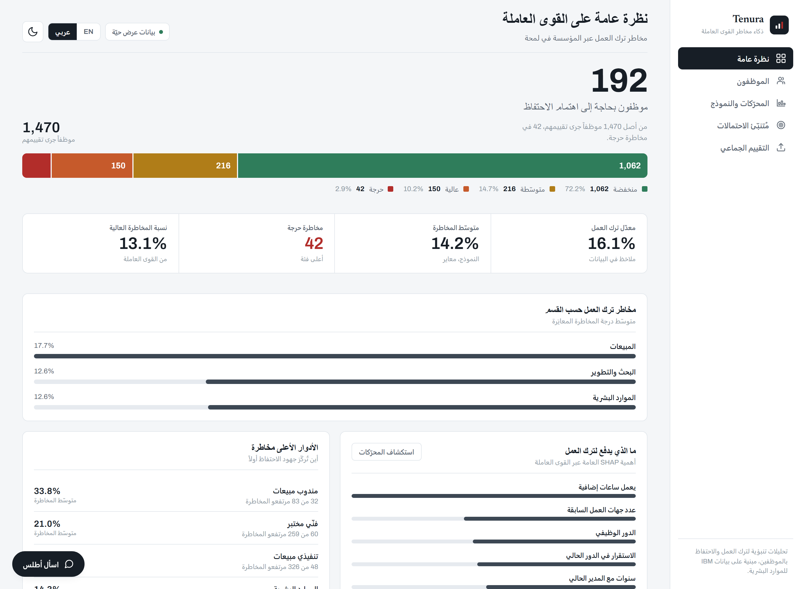
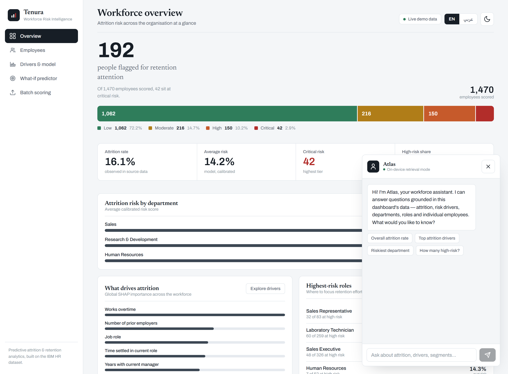
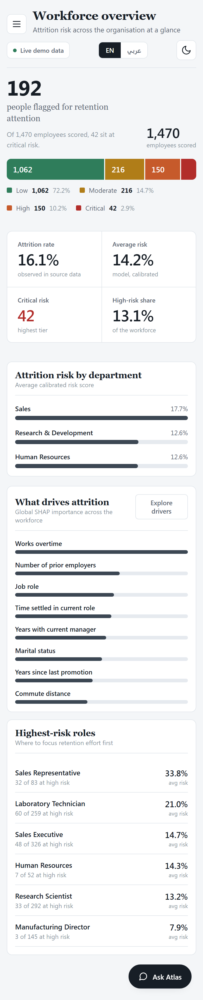
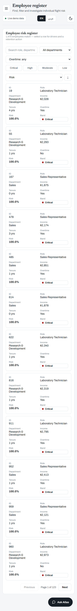

<div align="center">

# Tenura

### Employee attrition & workforce-risk intelligence

Predict who is likely to leave, understand **why**, and act before they do — a
trained ML model, a documented REST API, and a modern analytics dashboard.

**[▶ Live dashboard](https://mustafa-elsherif.github.io/tenura/)** · [API](#api-reference) · [AI assistant](#ai-assistant) · [Run locally](#run-locally)



</div>

---

## What it is

Tenura turns a flat HR dataset into a decision tool. It scores every employee's
attrition risk, bands them (Low → Critical), explains each score with the factors
driving it, and recommends a concrete retention action. HR leaders get an overview;
managers get a register they can filter and drill into; analysts get a what-if
predictor and batch scoring — and an **AI assistant** that answers questions grounded
in the real data.

Built on the **IBM HR Employee Attrition** dataset (1,470 employees, 35 fields).
Every number in the product is computed from that data — nothing is mocked.

## Highlights

- **One model, trained once, served instantly.** Logistic Regression / Random
  Forest / XGBoost are compared by cross-validated ROC-AUC; the winner is calibrated
  and serialized. The API and dashboard load pre-computed artifacts at startup — a
  user never waits for training.
- **Explainable by design.** SHAP global importances and per-employee top drivers,
  with one-hot features aggregated back to readable names and mapped to retention
  actions.
- **Grounded AI assistant.** A chat assistant (Google Gemini on the backend, with a
  free grounded-retrieval fallback) that answers only from the real workforce data,
  never invents numbers, and replies in the user's language.
- **Bilingual, RTL-ready.** Full **English** and **Arabic** UI with right-to-left
  layout and a one-click language switch — every string is translated, nothing is
  hard-coded.
- **A deliberate visual identity.** Not a generic dark SaaS kit: a calm, editorial
  instrument — ink on cool "document" paper, structured with hairlines and whitespace,
  with a serif voice for headings and the workforce laid out as a single risk spectrum.
  Colour is reserved for one thing — the risk tier (Low → Critical). Dark mode is a
  deep neutral control-room tone, not purple.
- **Responsive to the phone.** The same system holds from 320px up: the stat band and
  charts reflow, the toolbar wraps, and the employee register becomes labelled cards on
  small screens — no clipped columns, no horizontal scroll.
- **Works live with or without a server.** The dashboard ships with the scored
  dataset bundled and a faithful in-browser replica of the model, so the public demo
  is fully interactive. Point it at the FastAPI backend and it switches to live calls.
- **Production shape.** Typed API with OpenAPI docs, tests, Docker for the whole
  stack, and CI/CD to GitHub Pages.

<div align="center">

| English | العربية (RTL) | AI assistant |
|:---:|:---:|:---:|
|  |  |  |

**Mobile** — the same system at 375px: a tight KPI grid and tables that become cards.

| Overview (mobile) | Employee register (mobile) |
|:---:|:---:|
|  |  |

</div>

## Model performance

Selected model: **Logistic Regression** (best cross-validated ROC-AUC), probabilities
calibrated with isotonic regression. Evaluated once on an untouched 15% test split:

| Metric | Test | | Cross-validated ROC-AUC |
|---|---|---|---|
| ROC-AUC | **0.790** | | Logistic Regression — **0.826** |
| PR-AUC | 0.521 | | XGBoost — 0.807 |
| Recall @0.5 | 0.361 | | Random Forest — 0.793 |
| Brier score | 0.102 | | |

Honest 70 / 15 / 15 stratified split. Exact figures are regenerated into
`ml/artifacts/metrics.json` on every training run.

## Architecture

```
            train once, offline                    load artifacts at startup
┌───────────────┐   ┌───────────────┐        ┌──────────────┐     ┌───────────────┐
│ IBM HR CSV    │──▶│ ml/train.py   │──▶ artifacts ──▶      │ backend (FastAPI)│──▶│ dashboard (SPA)│
│ 1,470 × 35    │   │ clean · model │   model.joblib        │ REST + OpenAPI   │   │ React + Vite   │
└───────────────┘   │ calibrate·SHAP│   scored_employees    └──────────────────┘   │ bundled demo + │
                    └───────────────┘   metrics · drivers          ▲               │ in-browser model│
                                        client_model.json ─────────┘ (also powers ──┘
                                                                     the offline demo)
```

| Folder | Contents |
|--------|----------|
| `ml/` | Training pipeline, feature engineering, serialized artifacts ([details](ml/README.md)) |
| `backend/` | FastAPI service, Pydantic schemas, tests, Dockerfile ([details](backend)) |
| `frontend/` | React + TypeScript dashboard ([details](frontend/README.md)) |
| `infra/` | nginx config, artifact sync, Hugging Face Spaces config |
| `.github/` | CI (tests + build) and GitHub Pages deploy workflows |

## Run locally

### Full stack with Docker (one command)
```bash
docker compose up --build
# Dashboard → http://localhost:8080
# API docs  → http://localhost:8000/docs
```

### Or run the pieces directly
```bash
# 1) (optional) retrain — artifacts are already committed
pip install -r requirements.txt
python ml/train.py

# 2) API
pip install -r backend/requirements.txt
cd backend && uvicorn app.main:app --reload      # http://localhost:8000/docs

# 3) Dashboard
cd frontend && npm install && npm run dev          # http://localhost:5173
```

## API reference

Interactive OpenAPI docs at `/docs`. Core endpoints:

| Method | Path | Purpose |
|--------|------|---------|
| GET | `/health` | Liveness + loaded model name |
| GET | `/metrics` | Model leaderboard, calibrated metrics, dataset summary |
| GET | `/employees` | Scored employees — filter (department, band, overtime, search), sort, paginate |
| GET | `/employees/{id}` | One employee with risk score, band and top drivers |
| POST | `/predict` | What-if: score a single employee record + live SHAP drivers |
| POST | `/predict/batch` | Upload a CSV, score every row, return ranked results |
| POST | `/chat` | Grounded assistant — `{message, lang, history}` → grounded reply |
| GET | `/drivers` | Global SHAP importances |
| GET | `/segments` | Aggregates by department, role, band, overtime, travel |

```bash
curl -X POST http://localhost:8000/predict \
  -H "Content-Type: application/json" \
  -d '{"OverTime":"Yes","MonthlyIncome":2400,"JobSatisfaction":1,"WorkLifeBalance":1}'
```

## AI assistant

The dashboard has a built-in chat assistant ("Atlas") that answers questions
**strictly grounded** in the live workforce data — attrition, drivers, departments,
roles, model metrics and individual employees. It never invents numbers, declines
out-of-scope questions, and replies in the user's language (Arabic UI → Arabic).

- **Provider:** Google Gemini, called **only from the backend** — the API key never
  reaches the browser.
- **Fallback:** if `GEMINI_API_KEY` is absent or Gemini is unavailable, the assistant
  uses a free deterministic retrieval engine over the same data, so it always works.
  The public demo (no backend) runs this engine **in the browser**.

### Set the key
```bash
cp .env.example .env
# edit .env:
GEMINI_API_KEY=your_key_here      # from https://aistudio.google.com/apikey
```
`.env` is git-ignored — the key is never committed. `docker compose up` passes it to
the backend automatically; nothing else is needed.

## Internationalisation
The UI ships in **English** and **Arabic** with full right-to-left layout. Switch with
the EN / عربي toggle in the header; the choice persists. All strings — including
driver names, retention actions and the assistant — are translated via `src/i18n.tsx`.

## Deployment

- **Dashboard** → GitHub Pages via `.github/workflows/deploy-pages.yml` (build + `actions/deploy-pages`). Live at **https://mustafa-elsherif.github.io/tenura/**.
- **Backend** → ships as a container with a one-command deploy: `render.yaml` (Render Blueprint) and `infra/spaces/` (Hugging Face Docker Space).

See [DEPLOYMENT.md](DEPLOYMENT.md) for the live URLs and any remaining manual step.

## Tests
```bash
cd backend && python -m pytest -q      # API + model serving
cd frontend && npm run build           # type-check + production build
```

## Data & license
Dataset: IBM HR Analytics Employee Attrition (public, synthetic). This repository is
a portfolio / client-demonstration project.
